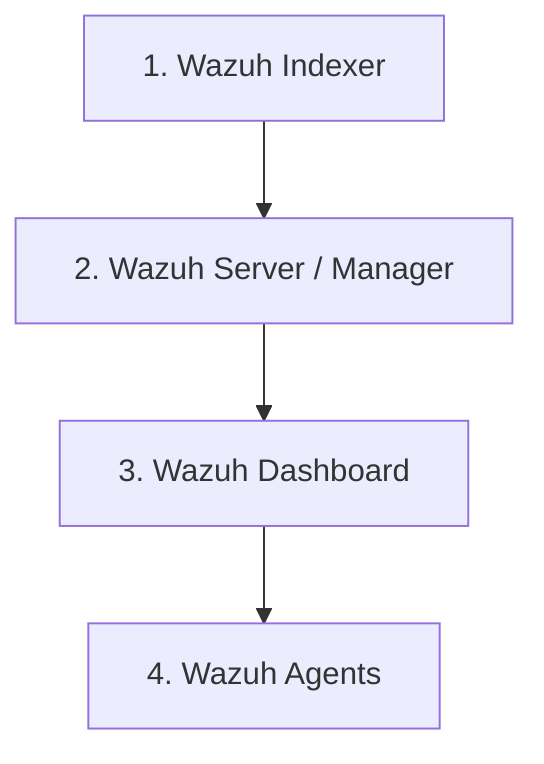

# Wazuh Server Upgrade Guide

This guide provides a comprehensive and safe procedure for upgrading an existing Wazuh deployment. It covers both single-node (all-in-one) installations (such as those installed using `wazuh-install.sh -a -i`) and distributed multi-node environments.

> [!IMPORTANT]
> **Documentation Only**: This document is an administrative guide. Do not attempt an automatic in-place upgrade without taking full system backups and verifying component compatibility first.

---

## Table of Contents

1. [Understanding the Architecture & Upgrade Principles](#1-understanding-the-architecture--upgrade-principles)
2. [Phase 1: Pre-Upgrade Assessment](#2-phase-1-pre-upgrade-assessment)
   - [Identifying Currently Installed Versions](#identifying-currently-installed-versions)
   - [Checking Supported Upgrade Paths and Release Notes](#checking-supported-upgrade-paths-and-release-notes)
3. [Phase 2: Backup Precautions (Mandatory)](#3-phase-2-backup-precautions-mandatory)
4. [Phase 3: Component Upgrade Execution](#4-phase-3-component-upgrade-execution)
   - [Strict Upgrade Sequence](#strict-upgrade-sequence)
   - [Step 1: Refresh Package Repositories](#step-1-refresh-package-repositories)
   - [Step 2: Upgrade Wazuh Indexer](#step-2-upgrade-wazuh-indexer)
   - [Step 3: Upgrade Wazuh Server (Manager)](#step-3-upgrade-wazuh-server-manager)
   - [Step 4: Upgrade Wazuh Dashboard](#step-4-upgrade-wazuh-dashboard)
   - [Step 5: Upgrade Wazuh Agents](#step-5-upgrade-wazuh-agents)
5. [Phase 4: Post-Upgrade Verification & Troubleshooting](#5-phase-4-post-upgrade-verification--troubleshooting)
6. [Official References](#6-official-references)

---

## 1. Understanding the Architecture & Upgrade Principles

Wazuh comprises three central components and endpoint agents:
- **Wazuh Indexer**: OpenSearch-based search and analytics engine that stores alerts and events.
- **Wazuh Server (Manager)**: Analysis engine, rule engine, agent enrollment manager, and API.
- **Wazuh Dashboard**: Web interface for event visualization and management.
- **Wazuh Agents**: Lightweight endpoints sending telemetry to the manager.

### Key Rules:
1. **Central Component Version Parity**: The Wazuh Indexer, Manager, and Dashboard must be upgraded to the same version (e.g., all at `4.14.x`).
2. **Backward Compatibility**: The Wazuh Manager is backward compatible with older agents (e.g., a 4.14 Manager can manage 4.10, 4.12, and 4.13 agents).
3. **Agent Constraint**: Wazuh Agents must **never** run a newer version than the Wazuh Manager.
4. **Configuration Preservation**: Package manager prompts should be instructed to **keep current configuration files** rather than overwriting them with package defaults.

---

## 2. Phase 1: Pre-Upgrade Assessment

### Identifying Currently Installed Versions

Before initiating an upgrade, record the exact versions of every installed component.

#### Wazuh Server (Manager)
- **Using Wazuh Control CLI**:
  ```bash
  sudo /var/ossec/bin/wazuh-control info -v
  # Or for detailed build information:
  sudo /var/ossec/bin/wazuh-control info
  ```
- **Using Debian/Ubuntu Package Manager**:
  ```bash
  dpkg -l | grep wazuh-manager
  ```
- **Using RHEL/CentOS/Fedora Package Manager**:
  ```bash
  rpm -q wazuh-manager
  ```

#### Wazuh Indexer
- **Using Package Manager**:
  ```bash
  # Debian / Ubuntu:
  dpkg -l | grep wazuh-indexer

  # RHEL / CentOS:
  rpm -q wazuh-indexer
  ```
- **Using Indexer REST API**:
  ```bash
  curl -k -u <ADMIN_USER>:<ADMIN_PASSWORD> https://127.0.0.1:9200
  ```

#### Wazuh Dashboard
- **Using Package Manager**:
  ```bash
  # Debian / Ubuntu:
  dpkg -l | grep wazuh-dashboard

  # RHEL / CentOS:
  rpm -q wazuh-dashboard
  ```

#### Wazuh Agents
- **From the Wazuh Server (all agents)**:
  ```bash
  sudo /var/ossec/bin/agent_control -l
  ```
- **Locally on a Linux Agent**:
  ```bash
  sudo /var/ossec/bin/wazuh-control info -v
  # Or:
  dpkg -l | grep wazuh-agent # Debian/Ubuntu
  rpm -q wazuh-agent         # RHEL/CentOS
  ```
- **Locally on a Windows Agent**:
  Check `C:\Program Files (x86)\ossec-agent\VERSION` or open the Wazuh Agent UI.

---

### Checking Supported Upgrade Paths and Release Notes

1. **Review Official Release Notes**:
   Visit the [Wazuh Release Notes](https://documentation.wazuh.com/current/release-notes/index.html) for all versions between your current version and target version.
2. **Identify Breaking Changes**:
   - Changes in index mappings or templates.
   - Deprecated configuration directives in `ossec.conf`.
   - OpenSearch / Lucene internal data format changes.
3. **Determine Multi-Step Paths (if applicable)**:
   - Upgrading within the same major version (e.g., `4.12.x` &rarr; `4.14.x`) can be performed directly using package managers.
   - Upgrading across major revisions (e.g., `3.x` &rarr; `4.x`) requires following intermediate migration steps documented in historical release notes.

---

## 3. Phase 2: Backup Precautions (Mandatory)

Always create complete, verifiable backups before running any upgrade command.

### 1. Full Virtual Machine / Cloud Snapshots
If running on cloud infrastructure (AWS, Azure, GCP) or hypervisors (VMware, Proxmox, Hyper-V):
- Create a point-in-time snapshot of the disk volumes while the server is stopped or quiesced.

### 2. File and Configuration Backups
Create backup archives of configurations, certificates, and encryption keys:

```bash
# Create a timestamped backup directory
BACKUP_DIR="/root/wazuh_backup_$(date +%F_%H%M%S)"
sudo mkdir -p "$BACKUP_DIR"

# 1. Wazuh Manager configurations, keys, and custom rules
sudo cp -rp /var/ossec/etc "$BACKUP_DIR/ossec_etc"
sudo cp -rp /var/ossec/ruleset "$BACKUP_DIR/ossec_ruleset" 2>/dev/null || true

# 2. Wazuh Indexer configuration and certificates
sudo cp -rp /etc/wazuh-indexer "$BACKUP_DIR/wazuh-indexer" 2>/dev/null || true

# 3. Wazuh Dashboard configuration and certificates
sudo cp -rp /etc/wazuh-dashboard "$BACKUP_DIR/wazuh-dashboard" 2>/dev/null || true

echo "Configuration backups saved to: $BACKUP_DIR"
```

### 3. Wazuh Indexer Snapshot
For critical security logs and event histories, initiate a snapshot of the OpenSearch/Indexer cluster:
```bash
curl -k -u <ADMIN_USER>:<ADMIN_PASSWORD> -X PUT \
  "https://127.0.0.1:9200/_snapshot/<MY_BACKUP_REPO>/snapshot_$(date +%F)?wait_for_completion=true"
```

---

## 4. Phase 3: Component Upgrade Execution

### Strict Upgrade Sequence

In both all-in-one and multi-node cluster deployments, components **must** be upgraded in the following exact order:



---

### Step 1: Refresh Package Repositories

Ensure the system repository points to the official Wazuh repository and keys are updated.

#### Debian / Ubuntu:
```bash
sudo apt-get update
```

#### RHEL / CentOS / AlmaLinux / Rocky Linux:
```bash
sudo yum clean all
sudo yum check-update
```

---

### Step 2: Upgrade Wazuh Indexer

1. **Stop the Indexer service**:
   ```bash
   sudo systemctl stop wazuh-indexer
   ```

2. **Upgrade the package**:
   - **Debian / Ubuntu**:
     ```bash
     sudo apt-get --only-upgrade install wazuh-indexer
     ```
   - **RHEL / CentOS / Rocky**:
     ```bash
     sudo yum upgrade wazuh-indexer
     ```

   > [!CAUTION]
   > When prompted about modified configuration files (e.g., `/etc/wazuh-indexer/opensearch.yml`), **choose to keep the existing version** (answer `N` or keep existing). Overwriting will erase TLS certificates, passwords, and cluster settings.

3. **Reload systemd and start the service**:
   ```bash
   sudo systemctl daemon-reload
   sudo systemctl enable wazuh-indexer
   sudo systemctl start wazuh-indexer
   ```

4. **Verify Indexer Status**:
   ```bash
   sudo systemctl status wazuh-indexer
   curl -k -u <ADMIN_USER>:<ADMIN_PASSWORD> https://127.0.0.1:9200
   curl -k -u <ADMIN_USER>:<ADMIN_PASSWORD> "https://127.0.0.1:9200/_cluster/health?pretty"
   ```
   Ensure cluster status reports `"status" : "green"` (or `"yellow"` on a single-node setup).

---

### Step 3: Upgrade Wazuh Server (Manager)

1. **Stop the Manager service**:
   ```bash
   sudo systemctl stop wazuh-manager
   ```

2. **Upgrade the package**:
   - **Debian / Ubuntu**:
     ```bash
     sudo apt-get --only-upgrade install wazuh-manager
     ```
   - **RHEL / CentOS / Rocky**:
     ```bash
     sudo yum upgrade wazuh-manager
     ```

   > [!CAUTION]
   > Keep your current `/var/ossec/etc/ossec.conf` if prompted by the package manager.

3. **Reload systemd and start the service**:
   ```bash
   sudo systemctl daemon-reload
   sudo systemctl enable wazuh-manager
   sudo systemctl start wazuh-manager
   ```

4. **Verify Manager Status**:
   ```bash
   sudo systemctl status wazuh-manager
   sudo /var/ossec/bin/wazuh-control info -v
   ```

---

### Step 4: Upgrade Wazuh Dashboard

1. **Stop the Dashboard service**:
   ```bash
   sudo systemctl stop wazuh-dashboard
   ```

2. **Upgrade the package**:
   - **Debian / Ubuntu**:
     ```bash
     sudo apt-get --only-upgrade install wazuh-dashboard
     ```
   - **RHEL / CentOS / Rocky**:
     ```bash
     sudo yum upgrade wazuh-dashboard
     ```

   > [!CAUTION]
   > Keep your current `/etc/wazuh-dashboard/opensearch_dashboards.yml` if prompted.

3. **Reload systemd and start the service**:
   ```bash
   sudo systemctl daemon-reload
   sudo systemctl enable wazuh-dashboard
   sudo systemctl start wazuh-dashboard
   ```

4. **Verify Dashboard Status**:
   ```bash
   sudo systemctl status wazuh-dashboard
   ```
   Access the web interface at `https://<YOUR_SERVER_IP>` and verify successful login.

---

### Step 5: Upgrade Wazuh Agents

Once central components are running and validated, upgrade endpoint agents.

#### Method A: Remote Upgrade (from Wazuh Server)
Wazuh Manager can remotely upgrade agents through the manager CLI or API without logging into each machine:

```bash
# List outdated agents eligible for upgrade:
sudo /var/ossec/bin/agent_upgrade -l

# Upgrade a specific agent by ID:
sudo /var/ossec/bin/agent_upgrade -a <AGENT_ID>

# Upgrade all eligible agents:
sudo /var/ossec/bin/agent_upgrade -a
```

#### Method B: Manual Upgrade on Endpoint
- **Debian / Ubuntu Agent**:
  ```bash
  sudo apt-get update
  sudo apt-get --only-upgrade install wazuh-agent
  sudo systemctl restart wazuh-agent
  ```
- **RHEL / CentOS Agent**:
  ```bash
  sudo yum upgrade wazuh-agent
  sudo systemctl restart wazuh-agent
  ```
- **Windows Agent**:
  Download the latest installer from the official repository and run:
  ```cmd
  msiexec.exe /i wazuh-agent-<VERSION>.msi /qn REINSTALLMODE=vamus REINSTALL=ALL
  ```
  Or run the graphical `.msi` wizard and choose the upgrade option.

---

## 5. Phase 4: Post-Upgrade Verification & Troubleshooting

### Verification Checklist

1. **Service Status**:
   ```bash
   sudo systemctl is-active wazuh-indexer
   sudo systemctl is-active wazuh-manager
   sudo systemctl is-active wazuh-dashboard
   ```
   All should report `active`.

2. **Manager Component Modules**:
   ```bash
   sudo /var/ossec/bin/wazuh-control status
   ```
   Ensure `wazuh-modulesd`, `wazuh-analysisd`, `wazuh-execd`, `wazuh-remoted`, etc., are all `running`.

3. **Agent Connection Status**:
   ```bash
   sudo /var/ossec/bin/agent_control -l
   ```
   Verify that registered agents reconnect to the manager.

4. **Web UI Verification**:
   - Check that security events and alerts are populating in the dashboard.
   - Navigate to **Server Management** &rarr; **Status** to confirm healthy communications.

---

### Troubleshooting Common Issues

| Issue | Typical Cause | Resolution |
| :--- | :--- | :--- |
| **"Wazuh server is down" on Dashboard** | API connection settings or service stopped | 1. Verify `sudo systemctl status wazuh-manager`.<br>2. Check API credentials in `/usr/share/wazuh-dashboard/data/wazuh/config/wazuh.yml`. |
| **Indexer cluster status `red`** | Unassigned shards or disk space threshold | 1. Check disk space with `df -h`.<br>2. Inspect shards with `curl -k -u <user>:<pass> "https://127.0.0.1:9200/_cat/shards?v"`. |
| **Certificates / SSL handshake failure** | Config files overwritten by package update | Restore original certificate files and YAML configs from `$BACKUP_DIR`. |
| **Agents disconnected after upgrade** | Firewall rule or `remoted` port blocked | Ensure TCP/UDP port 1514 is open and `client.keys` in `/var/ossec/etc/` matches agent keys. |

### Relevant Log Files for Inspection
- **Wazuh Manager**: `/var/ossec/logs/ossec.log` and `/var/ossec/logs/api.log`
- **Wazuh Indexer**: `/var/log/wazuh-indexer/wazuh-cluster.log`
- **Wazuh Dashboard**: `sudo journalctl -u wazuh-dashboard -e`
- **Wazuh Agent**: `/var/ossec/logs/ossec.log`

---

## 6. Official References

For version-specific notes, refer directly to official Wazuh documentation:
- [Wazuh Upgrade Guide](https://documentation.wazuh.com/current/upgrade-guide/index.html)
- [Wazuh Central Components Upgrade](https://documentation.wazuh.com/current/upgrade-guide/wazuh-central-components.html)
- [Wazuh Agent Upgrade](https://documentation.wazuh.com/current/upgrade-guide/wazuh-agent/index.html)
- [Wazuh Release Notes](https://documentation.wazuh.com/current/release-notes/index.html)
- [Wazuh Indexer Documentation](https://documentation.wazuh.com/current/user-manual/wazuh-indexer/index.html)
